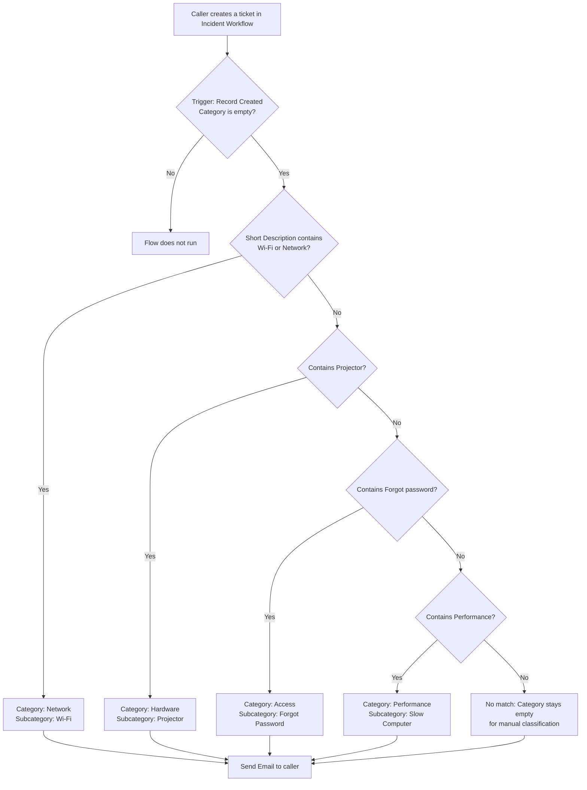

# Auto Ticket Classification using Flow Designer

A ServiceNow project that automatically classifies school IT support tickets. When a new ticket is created, a **Flow Designer** flow reads the **Short Description**, fills in the correct **Category** and **Subcategory**, and sends a confirmation email to the caller. No manual classification is needed.

**Team ID:** SWTID-2026-2351  
**Author:** Deepa M ([GitHub](https://github.com/Deepamadesh))  
**Platform:** ServiceNow (Workflow Studio / Flow Designer)

---

## Table of Contents
1. [Problem Statement](#problem-statement)
2. [Solution Overview](#solution-overview)
3. [Features](#features)
4. [How It Works](#how-it-works)
5. [Data Model](#data-model)
6. [Classification Rules](#classification-rules)
7. [Flow Configuration](#flow-configuration)
8. [Setup and Installation](#setup-and-installation)
9. [Testing](#testing)
10. [Screenshots](#screenshots)
11. [Tech Stack](#tech-stack)
12. [Limitations and Future Enhancements](#limitations-and-future-enhancements)

---

## Problem Statement
School IT support teams receive many tickets every day. Choosing the Category and Subcategory for each ticket by hand is repetitive and slow, and it can lead to wrong classification. Wrong or missing categories delay ticket routing and make the helpdesk less efficient.

## Solution Overview
The project uses ServiceNow **Flow Designer** to classify tickets automatically. The flow starts when a ticket is created without a Category. It checks the Short Description for keywords, updates the Category and Subcategory on the ticket, and sends an email notification to the caller.

## Features
- Automatic Category and Subcategory assignment from keywords in the Short Description
- Four ticket types supported: Network, Hardware, Access and Performance
- Dependent Subcategory choice list that follows the selected Category
- Email notification to the caller for every new ticket
- Flow runs only on tickets whose Category is empty, so manual choices are never overwritten
- Complete solution packaged in a ServiceNow Update Set

## How It Works



## Data Model
A custom table **Incident Workflow** (`u_incident_workflow`) stores the tickets.

| Field | Description |
|---|---|
| Number | Auto-generated ticket number (for example, INC0001018) |
| Caller | The user who reports the issue |
| Category | Network, Hardware, Access or Performance |
| Subcategory | Depends on the selected Category (see below) |
| Short Description | Brief summary of the issue (used for keyword matching) |
| Description | Full details of the issue |
| State | New, In progress, On hold, Resolved, Closed |
| Assigned Group | Support group handling the ticket |
| Assigned to | Support staff member handling the ticket |

**Category and Subcategory choices**

| Category | Subcategory |
|---|---|
| Network | Wi-Fi |
| Hardware | Projector |
| Access | Forgot Password |
| Performance | Slow Computer |

The Subcategory field uses **Dependent field = Category**, so only the matching Subcategory choices appear for the selected Category.

## Classification Rules

| Condition label in flow | Short Description contains | Category | Subcategory |
|---|---|---|---|
| SD is Wifi or Network | `Wi-Fi` or `Network` | Network | Wi-Fi |
| SD is Projector or Hardware | `Projector` | Hardware | Projector |
| SD is Forgot password | `Forgot password` | Access | Forgot Password |
| SD is Performance | `Performance` | Performance | Slow Computer |

Conditions are checked in order (If / Else If). The first match wins.

## Flow Configuration

| Setting | Value |
|---|---|
| Flow name | Auto Classify School IT Tickets |
| Built with | Workflow Studio (Flow Designer) |
| Status | Active |
| Trigger | Incident Workflow **Created** where **Category is empty** |
| Logic | If / Else If on Short Description (4 branches) |
| Branch action | **Update Record** on the triggering ticket (sets Category and Subcategory) |
| Final action | **Send Email** to the caller |

**Email notification**
- **To:** the caller's email address from the ticket
- **Subject:** Your Request for the issue has been submitted.
- **Body:** Ticket confirmation message.

The Send Email action sits after all the branches, so the caller is notified for every new ticket, whether or not a keyword matched.

## Setup and Installation

### Prerequisites
- A ServiceNow instance (a free Personal Developer Instance works)
- Admin access
- The exported Update Set file `Project_Update_Set.xml`

### Steps
1. Log in to your instance as an administrator.
2. Go to **System Update Sets → Retrieved Update Sets** and choose **Import Update Set from XML**.
3. Upload `Project_Update_Set.xml`.
4. Open the retrieved update set (**Project Update Set**), click **Preview Update Set**, resolve any problems, then click **Commit Update Set**.
5. Open **Workflow Studio → Flows**, find **Auto Classify School IT Tickets**, and make sure it is **Active** (click **Activate** if needed).
6. Make sure the users you use as callers have an **email address** in their user record.

The update set contains the custom table, its fields, the Category / Subcategory / State choice lists and the dictionary entries (35 customer updates).

## Testing
1. Go to **All → Incident Workflow → New**.
2. Select a **Caller** and enter a **Short Description** (leave Category empty).
3. Save the ticket and check that Category and Subcategory are filled in automatically.
4. Check **Workflow Studio → Operations / Executions** to confirm the flow run shows **Completed**, and check the outbound email log for the notification.

| Short Description (example) | Expected Category | Expected Subcategory |
|---|---|---|
| Wi-Fi not working in library | Network | Wi-Fi |
| Projector not turning on in Class 5 | Hardware | Projector |
| Forgot password for school portal | Access | Forgot Password |
| Performance issue on lab computer | Performance | Slow Computer |

## Screenshots

### Ticket form with an automatically classified ticket


### Data model
| | |
|---|---|
| Custom table |  |
| Form design |  |
| Category choices |  |
| Subcategory dependent on Category |  |
| Subcategory choices |  |
| State choices |  |

### Flow


| | |
|---|---|
| Condition: Wi-Fi or Network |  |
| Update Record: Network / Wi-Fi |  |
| Condition: Projector |  |
| Update Record: Hardware / Projector |  |
| Send Email action |  |
| Flow execution details |  |

### Update Set
| | |
|---|---|
| Update set contents |  |
| Update set (Studio view) |  |

## Tech Stack

| Component | Technology |
|---|---|
| Platform | ServiceNow (cloud) |
| Automation | Flow Designer / Workflow Studio |
| Data | Custom table `u_incident_workflow` |
| Notification | ServiceNow Send Email action |
| Packaging | Update Set (XML) |

## Limitations and Future Enhancements
- **Keyword matching uses "contains".** Spelling variants such as `WiFi` (without the hyphen) need their own keyword in the condition.
- Tickets with no matching keyword keep an empty Category and must be classified manually.
- Only four categories are covered so far. More categories and subcategories (for example Printer, Email, Software) can be added as new If / Else If branches.

Possible future work:
- Machine-learning based classification (for example ServiceNow Predictive Intelligence)
- Automatic assignment of the Assigned Group based on Category
- Dashboard and reports on tickets by Category and State

## Project Structure
```
auto-ticket-classification/
├── README.md
├── Project_Update_Set.xml      # exported update set (add this file)
└── screenshots/                # project screenshots used in this README
```

## Author
**Deepa M** – [GitHub](https://github.com/Deepamadesh)
